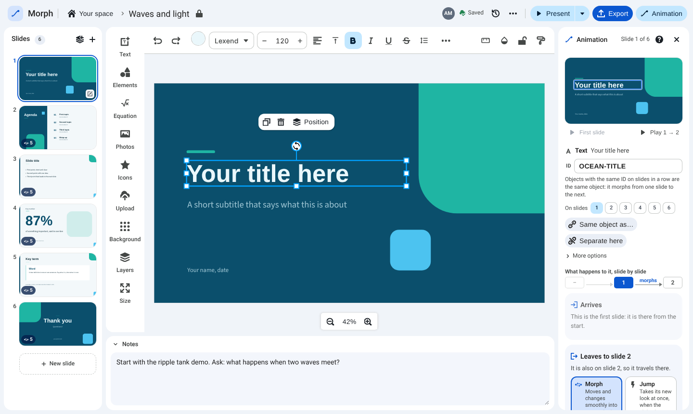
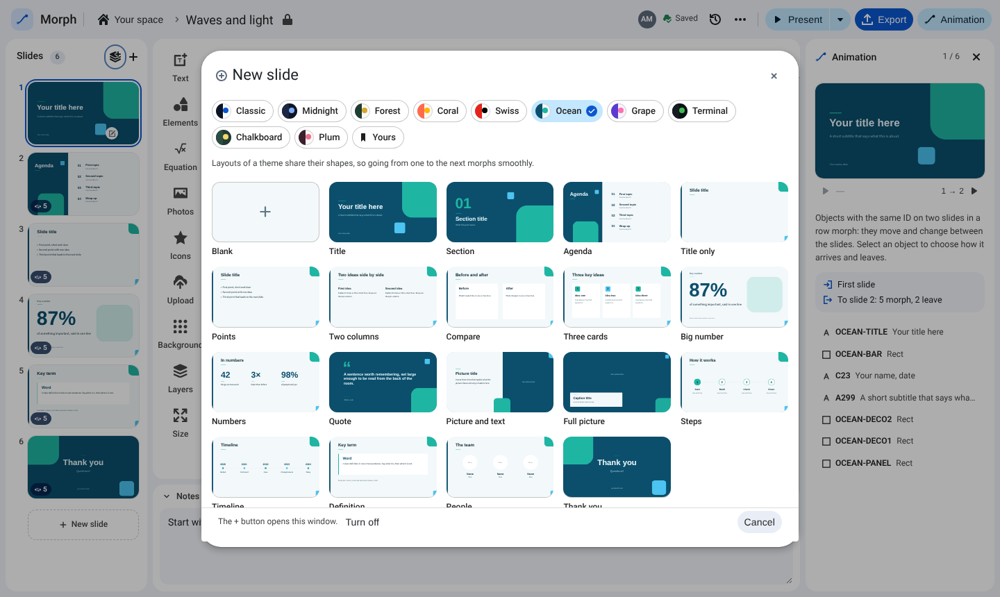

# Morph

**Slides where things move.** Give an object the same ID on two slides in a row, and when you present it glides,
grows and changes color from one slide to the next, like Keynote's Magic Move or PowerPoint's Morph. In your
browser, free, and you can edit together with other people at the same time.



> **Honest note.** All of this code was written by an AI (Claude, by Anthropic), directed step by step by one person
> who needed it for real presentations and classes. A 100% human need, 100% AI-written code. It works and it is
> tested, but expect bugs: for anything important, keep a copy (**⋯ → Download project file**) and the exported `.html`.

## What it does

- **Morph animations.** Objects with the same ID on neighbouring slides move and change between them. For each
  object you choose how it arrives and leaves (morph, jump, fade), how long it takes and how it moves.
  Copy an object and paste it on the next slide: it keeps its ID, so it morphs.
- **Themes.** 10 themes, each with the same 18 layouts (title, section, agenda, points, compare, big number, quote,
  timeline, definition…). Layouts of a theme share their shapes, so going from one to the next morphs on its own.
  Once a theme is chosen, **+** offers its layouts. Switch theme later and the slides follow.
- **Together, without accounts.** Every person you invite gets their own secret link. They open it and they are in,
  live, with no account. Remove a person and their link stops working.
- **Speaker notes** for each slide, visible to you while presenting (press **S**, drag them anywhere). The
  exported file never shows them; they are only in its code, as an HTML comment per slide.
  Slides can be **assigned to someone**, and everyone can show **only their own slides**.
- **Equations** in LaTeX, with a package manager (physics, mhchem, siunitx, braket, cancel…): turn packages on
  once for the presentation instead of writing `\usepackage`. Drop your own `.sty` or `.tex` file and its
  `\newcommand` / `\DeclareMathOperator` lines work in every equation.
- **Every Google Font** (1,800+), free **photos** (Wikimedia Commons, with the credit added to your notes) and **icons** (Iconify).
- **Present** with the keyboard or a classroom clicker (Page Up/Down, B for a black screen, L for a laser dot), and
  **export** one standalone `.html` file that plays anywhere, even offline.
- **Version history** like Google Slides: saved continuously, name a version, go back, make a copy.
- **English and French**, following your browser.



## Try it

[ruelustin5.github.io/morph](https://ruelustin5.github.io/morph/) is one person's own space: without a link
someone shared with you, there is nothing to open there. To use Morph yourself, make your own space below. It's free.

## Make your own space

You need a **GitHub account** and a **Google account**. No credit card, no server to rent, about 20 minutes.

```
your copy of this code (GitHub)  ──►  your website (GitHub Pages, free)
                                          │
                                          ▼
                       your projects (Firebase, free "Spark" plan, Google)
```

1. **Fork** this repository: the **Fork** button at the top of this page, then **Create fork**.
2. **Create a Firebase project** with sign-in, a database and their security rules
   ([SETUP.md](SETUP.md), steps 1 to 5).
3. **Put your Firebase settings** and your site's address into `src/web/firebase-config.js` ([SETUP.md](SETUP.md), step 6).
4. **Turn on GitHub Pages** for your fork ([SETUP.md](SETUP.md), step 7).
5. **Open your site** (`https://YOUR-GITHUB-NAME.github.io/morph/`) and click **This is my space: sign in**.
   The first Google account to do this owns the space.

Step-by-step instructions, with what you should see after each step and fixes for common problems: **[SETUP.md](SETUP.md)**.

### The lazy way: let an AI agent do it

If you use an AI agent that can control your browser (for example Claude in Chrome), sign in to
**github.com** and **console.firebase.google.com** yourself first, then give it this:

````text
Set up my own copy of Morph, a slide editor, by following SETUP.md in https://github.com/ruelustin5/morph exactly,
step by step. I am already signed in to github.com and console.firebase.google.com in this browser.

Rules:
- Use only the free Firebase "Spark" plan. Never upgrade to Blaze, never open billing, never enter payment details.
- Never type a password. If a sign-in is needed, stop and ask me to do it.
- Fork the repository to my GitHub account (keep the name "morph") instead of creating one from scratch.
- After each step, check the "✔" line of that step in SETUP.md. If what you see is different, stop and tell me
  what you see instead of guessing.
- When editing src/web/firebase-config.js, replace every value, including site (my GitHub name + ".github.io").
- Paste firestore.rules and database.rules.json exactly as they are in my fork, then click Publish.
- At the end, open my site, tell me its address, and tell me to click "This is my space: sign in" myself.
````

## Is it safe?

The code is public on purpose, and that is fine: the protection does not come from hiding the code but from
**Firebase's security rules**, which run on Google's servers and are checked on every read and write.

| What | Where it is | Who can read it |
|---|---|---|
| Your private projects | Firebase (Firestore) | Only your Google account. The rules refuse everyone else. |
| A shared project | Firebase, under a long random place name | Only people with a link. It is **encrypted in the browser** (AES-256-GCM) before it is sent: Firebase only stores scrambled data. |
| A project's key | Inside the link, after the `#` | Browsers never send the part after `#` to any server. |
| People's names | Inside the encrypted project, and in the live "who's here" of that project | Only people with that project's link. |
| This repository | GitHub, public | Everyone. It has **no secrets and no personal information**. The Firebase settings in `firebase-config.js` only say which project to use; Google designed them to be public. |

- Removing someone gives the project a new key and re-issues the other links, so an old link (or a copy of the old
  data) is useless.
- Nobody can list the shared places, create new ones, or claim a space that already has an owner.
- A copy published at another address that still has someone else's settings refuses to connect to their Firebase
  and shows how to set up its own.
- Limits to know: anyone with a project's link can edit or delete that project (like an editor in Google Slides);
  the free plan has daily limits, and if one is reached the database pauses until the next day. It never charges.
- Optional extra protection: in the Google Cloud console, restrict your Firebase API key to your site's address
  (APIs & Services → Credentials → the "Browser key" → Website restrictions: `https://YOUR-GITHUB-NAME.github.io/*`
  and `https://YOUR-PROJECT.firebaseapp.com/*`).

## For developers

```bash
npm ci                  # .npmrc allows the editor's older React peer ranges
node build.mjs web      # the website → dist-web/ (what GitHub Pages publishes on every push to main)
node build.mjs webtest  # the website with a fake Firebase that enforces the same rules → dist-webtest/
node build.mjs          # the Claude artifact version → dist/
```

End-to-end tests (Playwright, against the fake Firebase) are in `test/e2e/`. How everything fits together
(live editing, encryption, versions, themes, languages): **[docs/HOW-IT-WORKS.md](docs/HOW-IT-WORKS.md)**.

Built with [OpenPolotno](https://www.npmjs.com/package/@reyka/openpolotno) (MIT) for the editor,
[MathJax](https://www.mathjax.org) (Apache 2.0) for equations, Firebase, Google Fonts, Wikimedia Commons and Iconify.
